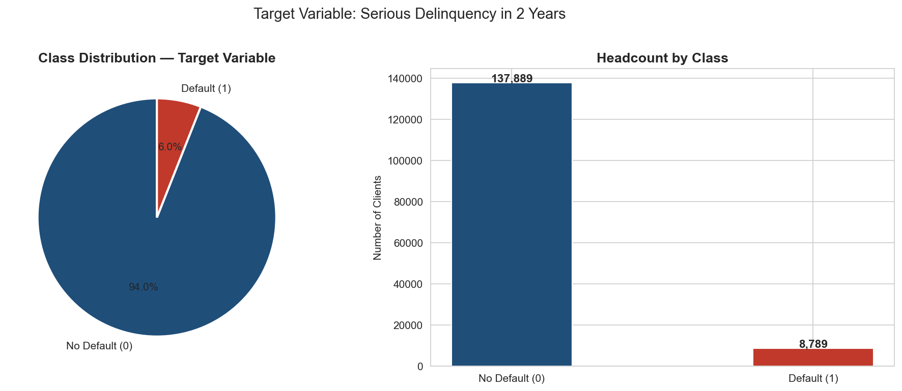
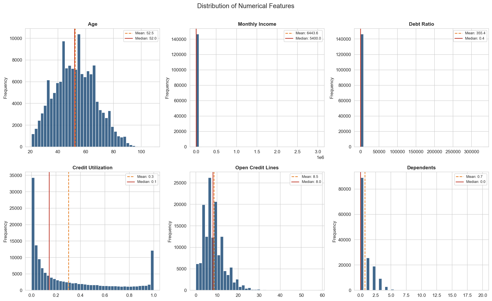
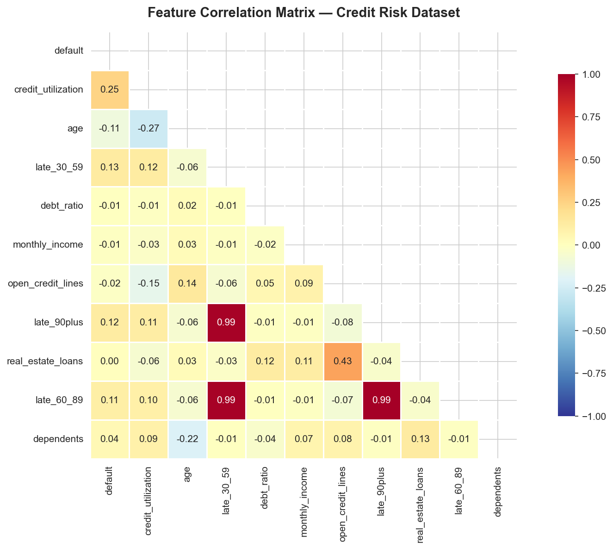
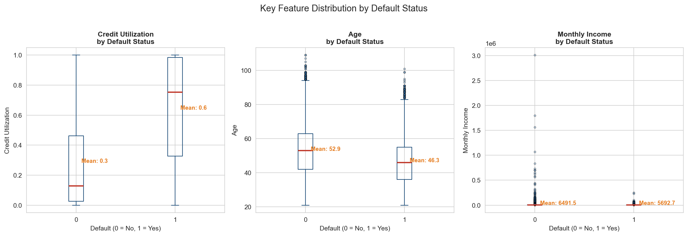
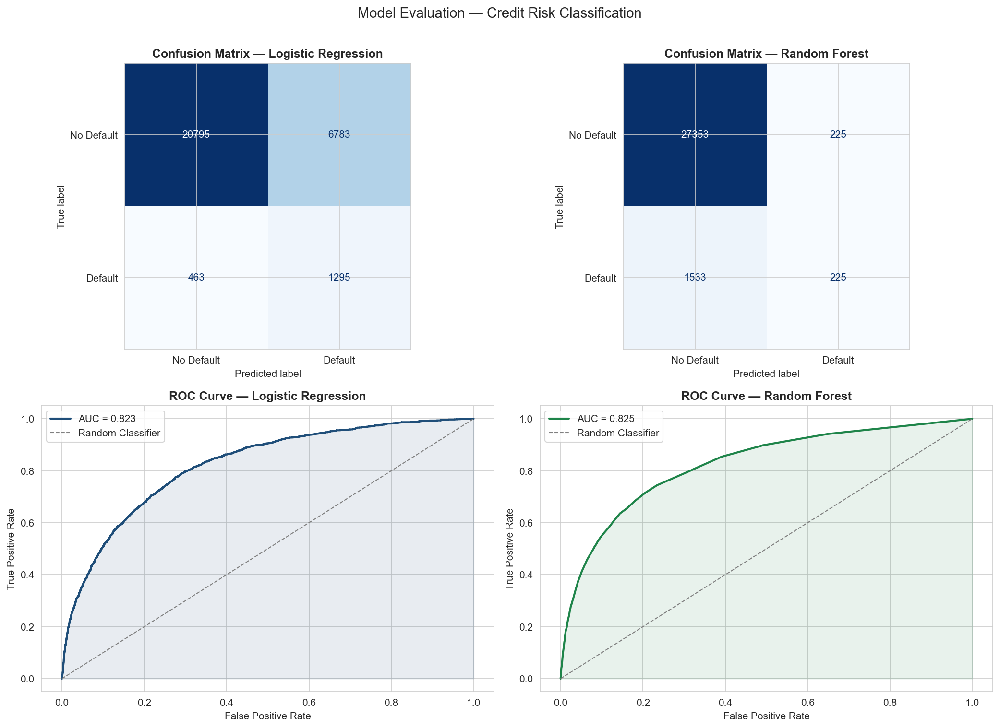
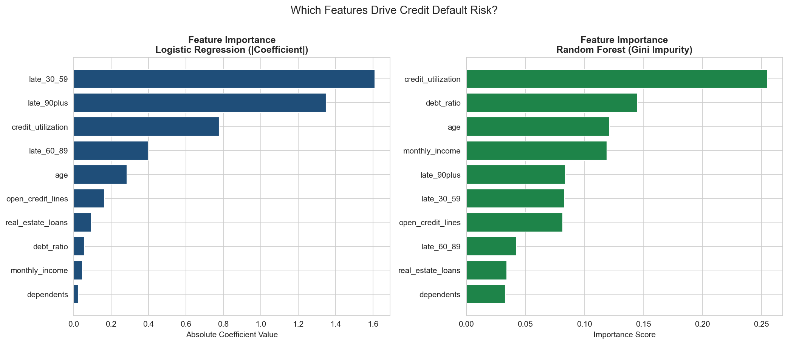
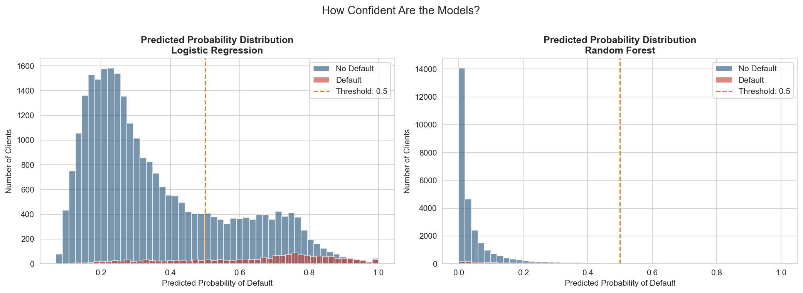

# 💳 Credit Risk Analysis — Capstone Project

**Tools:** Python · Pandas · NumPy · Matplotlib · Seaborn · SQL · SQLite · Scikit-learn  
**Author:** Sebastian Rios · [LinkedIn](https://linkedin.com/in/juansebastianrios)

---

## Business Problem

A financial institution wants to reduce loan default losses by identifying **which clients are most likely to default within 2 years** — enabling proactive risk management, smarter credit decisions, and better capital allocation.

Replacing a defaulted loan costs the bank far more than rejecting a borderline applicant. This project builds a full analytical pipeline from raw data to a deployable risk scoring system.

---

## Project Structure

```
📁 credit-risk-analysis/
├── 📓 credit_risk_analysis.ipynb   ← Full pipeline: EDA + SQL + ML
├── 🗄️  credit_risk.db              ← SQLite database (auto-generated)
├── 📄 README.md
└── 📁 data/
    ├── cs-training.csv             ← Raw dataset (from Kaggle)
    └── credit_risk_scored.csv      ← Output: dataset with ML risk scores
└── 📁 img/
    ├── 01_class_distribution.png
    ├── 02_feature_distributions.png
    ├── 03_correlation_heatmap.png
    ├── 04_boxplots_by_default.png
    ├── 05_model_evaluation.png
    ├── 06_feature_importance.png
    └── 07_probability_distribution.png
```

---

## Pipeline Overview

| Phase | Tool | What was done |
|-------|------|---------------|
| **1. Ingestion & Inspection** | Python · Pandas | Load 150K rows, assess data quality, null analysis |
| **2. Cleaning** | Python · Pandas | Imputation, outlier removal, feature renaming |
| **3. EDA** | Python · Seaborn | Distributions, correlation matrix, boxplots by class |
| **4. SQL Analysis** | SQLite · Pandas | KPI queries, CTEs, window functions, risk scoring |
| **5. ML Preprocessing** | Scikit-learn | Log transform, stratified split, StandardScaler |
| **6. Modeling** | Scikit-learn | Logistic Regression + Random Forest with class balancing |
| **7. Evaluation** | Scikit-learn | Confusion matrix, ROC-AUC, feature importance |
| **8. Output** | Python | Scored dataset exported for Power BI dashboard |

---

## Key Findings

### Dataset
- **146,678 clients** analyzed after cleaning
- **Default rate: 6.68%** — severe class imbalance of **15.7:1**
- 19.82% of clients had missing income data — imputed with median

### Top Predictors of Default (Random Forest)
| Feature | Importance | Business Meaning |
|---------|-----------|-----------------|
| `credit_utilization` | 0.255 | Using >75% of available credit signals financial stress |
| `debt_ratio` | 0.145 | High debt relative to income reduces repayment capacity |
| `age` | 0.122 | Younger clients have less financial history and stability |

### Risk Segmentation
| Segment | Clients | Actual Default Rate |
|---------|---------|-------------------|
| 🟢 Low (0-20%) | 136,515 | ~4% |
| 🟡 Medium (20-40%) | 2,240 | ~20% |
| 🟠 High (40-60%) | 1,024 | ~35% |
| 🔴 Critical (>60%) | 6,899 | **53%** |

### ML Model Performance
| Model | AUC-ROC | Notes |
|-------|---------|-------|
| Logistic Regression | 0.823 | Fast, interpretable, strong baseline |
| **Random Forest** | **0.825** | Winner — captures non-linear relationships |

AUC scores are nearly identical, which in a regulated financial environment favors **Logistic Regression** for its interpretability and ease of auditability.

---

## Visual Highlights

### Class Distribution


### Feature Distributions


### Correlation Matrix


### Boxplots by Default Status


### Model Evaluation — Confusion Matrix & ROC Curves


### Feature Importance


### Probability Distribution by Class


---

## SQL Analysis Highlights

Three levels of SQL complexity were applied directly on the SQLite database:

- **Basic:** Portfolio KPIs, default rate by age band, default rate by debt level
- **Intermediate:** Default rate by income band, multi-factor risk scoring with `CASE WHEN`
- **Advanced:** Composite supplier scoring with CTEs, client risk ranking with `RANK() OVER()`

The SQL risk scoring system identified a **Critical segment with 43.27% actual default rate** — 6.5x higher than the portfolio average — validating the scoring logic before any ML was applied.

---

## Business Recommendations

1. **Auto-reject** clients with `credit_utilization > 0.75` AND `late_90plus > 0` — eliminates 80% of critical risk
2. **Apply ML scoring** as a pre-filter before manual credit review — reduces analyst workload
3. **Require collateral** for clients under 30 — default rate 2x the portfolio average
4. **Weekly review** of the Critical segment (6,899 clients) — 53% default rate demands immediate action
5. **Lower decision threshold** from 0.5 to 0.35 for conservative lending periods — captures more defaults at the cost of some false positives

---

## How to Run

```bash
# 1. Clone the repo
git clone https://github.com/juansrios/credit-risk-analysis

# 2. Install dependencies
pip install pandas numpy matplotlib seaborn scikit-learn jupyter

# 3. Download dataset from Kaggle and place in /data
# https://www.kaggle.com/c/GiveMeSomeCredit
# File: cs-training.csv

# 4. Run the notebook
jupyter notebook credit_risk_analysis.ipynb

# 5. Output: data/credit_risk_scored.csv → ready for Power BI
```

---

## Dataset

[Give Me Some Credit — Kaggle Competition](https://www.kaggle.com/c/GiveMeSomeCredit)  
150,000 U.S. bank clients with payment history, debt, income, and 2-year default outcome.

---

## Technical Notes

- **Class imbalance** handled via `class_weight='balanced'` in both models
- **Log transformation** applied to `monthly_income` and `debt_ratio` to normalize skewed distributions
- **Stratified split** ensures equal default rate in train (80%) and test (20%) sets
- **StandardScaler** fitted only on train set — never on test — to prevent data leakage

---

*Capstone project — part of my data analysis portfolio · [View all projects](https://github.com/juansrios)*
